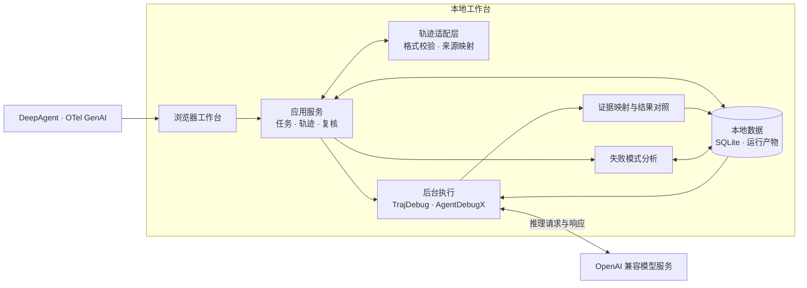

# 天罗智能轨迹诊断系统架构

天罗把已采集的 Agent 轨迹转成**可核验的单轨迹诊断**，再基于已保存的诊断分析跨轨迹的重复失败模式。工作台面向研发和评测人员，负责组织任务、查看证据、人工复核和导出。后台支持 TrajDebug、AgentDebugX 和两路并行对照。

## 系统全景

## 从业务轨迹到诊断证据

1. **导入与适配。** 用户在创建任务或轨迹库上传 DeepAgent、OTel GenAI 文件。适配层保留原始 span，生成调用视图所需的数据，同时还原可供诊断的线性消息序列及其来源映射。校验在本地完成。业务结果未知时需要在开始分析前补齐。只有耗时和 token，或模型并发分支无法还原为串行会话的 OTel 轨迹，会在导入时给出具体错误。
2. **任务与执行。** 相同轨迹在库中去重，可以被多个任务复用。分析任务定义排查目标和轨迹范围。每轮分析形成独立记录，保存模型连接、提示词语言和执行参数快照。后台按轨迹排队执行，失败重试与重新生成均保留请求历史。
3. **诊断与证据。** TrajDebug 接收统一消息，给出错误触发、实例与生命周期。AgentDebugX 将同一消息投影为带来源的事件，运行官方检测、深度归因和恢复建议。两种引擎各自保存原始输出，都能将证据跳回现有轨迹视图。
4. **双路对照与复核。** 双路任务并行运行两个引擎，对齐关键步骤与原文引文。任务详情保留每路状态，主报告优先展示既有标准诊断结论。任一路失败时保留另一方结果。人工复核单独保存。
5. **跨轨迹分析。** 失败模式分析固定选用的诊断和复核记录，在本地对具备可用归因的失败轨迹分组。双路报告经人工复核后再参与聚合，样本仍需满足既有归因和证据条件。

离线评估通过独立脚本复用后台诊断引擎，使用标准 JSON、JSONL 及固定的数据分区。评分读取独立标注和已保存的诊断结果。 [RSI 离线评估](rsi-evaluation.md)

## 关键设计决策

| 决策 | 理由与约束 |
| --- | --- |
| 在适配层处理来源差异 | 新增轨迹来源时复用调用视图和诊断输入契约。适配至少要交代消息顺序、业务结果和证据如何回到原始记录。 |
| 分别保留调用时间和诊断顺序 | 调用区间回答什么时候发生、哪些调用重叠。诊断步骤回答算法按什么顺序看到消息。来源映射让两个视图可以互相核对。 |
| 轨迹归库，结果归分析轮次 | 共享原始轨迹，保留不同模型和配置的诊断结果。删除任务会保留库内轨迹。仍被引用的轨迹或来源诊断受引用保护。 |
| 固定上游源码，在运行边界适配 | TrajDebug 和 AgentDebugX 分别从仓库内置源码加载并校验哈希。两套运行器都按任务选择语言。AgentDebugX 的分阶段中文模板与上游代码分开维护，英文沿用固定版模板。 |

## 部署与数据边界

默认按单机工作台部署。应用服务提供浏览器页面和 API，队列从本地数据库领取作业，诊断及改进建议在独立进程执行。业务轨迹、分析记录和复核保存在本地，原始运行产物保存在数据目录中。

两套诊断引擎共用系统设置中的默认模型连接，双路分析使用同一份轮次配置。分析记录保存接口地址、模型标识、运行参数和连接 ID。后端执行时从对应连接读取 API Key 与自定义 Header。使用远程模型时，推理所需的轨迹内容会发送到所选模型服务。文件校验、时序展示、人工复核和已有诊断的聚合均由本地工作台处理。

## 文档维护

当系统边界、组件职责、轨迹接入、诊断契约、数据引用关系或部署方式变化时，随代码更新对应段落或架构图。这里记录当前系统如何工作及关键决策的理由。接口字段、算法阶段、实验结果和部署命令各自维护在专项文档中。

- [用户旅程](user-journey.md)
- [TrajDebug 接入与运行参考](trajdebug-integration.md)
- [AgentDebugX 接入与运行参考](agentdebugx.md)
- [OTel GenAI 接入说明](otel-genai.md)
- [算法优化维护日志](algorithm-optimization-log.md)
