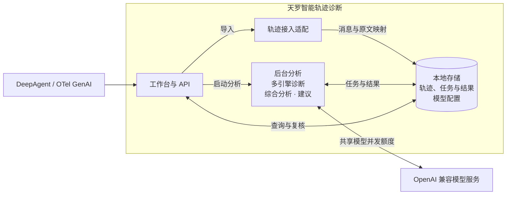

# 天罗智能轨迹诊断系统架构

天罗面向 Agent 研发和评测人员，将采集到的轨迹转成可回溯原文的诊断结论。工作台负责组织分析任务、查看证据和人工复核。后台按诊断等级运行引擎，并为单条轨迹或任务内的 Agent 生成改进建议。

## 系统全景

## 从导入到结论

1. **接入与归库。** 用户可从任务或轨迹库导入 DeepAgent、OTel GenAI 文件。适配层校验业务结果，保留原始 span，生成按调用时间展示的视图和按诊断顺序排列的统一消息。步骤与原文的映射让用户可以从诊断结论回到执行记录。同一轨迹归库去重，可被多个任务复用。
2. **任务与诊断。** 启动分析时保存诊断等级、提示词语言、模型连接与运行参数。本次执行中的重试沿用这份配置。队列按轨迹调度，多引擎在同一轨迹上独立并行，分别保存结论、证据和运行状态。
3. **综合与复核。** 业务失败且至少两路完成时，综合分析评估已完成引擎的结论和原文证据。全部引擎定位到同一有效步骤时，采用一致步骤并标记免复核，引用缺口单独提示。存在分歧时，证据支持最高且唯一的步骤可作为暂定结果，需人工复核。无法选定时保留待定状态。人工复核优先展示，原始诊断保留供核对。

| 诊断等级 | 运行引擎 |
| --- | --- |
| Fast | AgentDebugX |
| Standard（默认） | AgentDebugX、CHIEF |
| Deep | TrajDebug、AgentDebugX、CHIEF |

AgentDebugX 提供检测、归因和恢复推演。CHIEF 提供子任务依赖、因果回溯和关键步骤。TrajDebug 提供错误触发、错误实例和生命周期。各引擎使用仓库中固定并校验的源码基线，通过运行适配接入统一消息、模型连接和中英文提示词。

## 结果与改进建议

| 使用范围 | 处理方式 |
| --- | --- |
| 轨迹详情 | 「综合分析」默认展示结论总览，并提供本次运行的引擎子页签。关键步骤、引文和人工复核可从这里核对。 |
| 单轨迹改进建议 | 独立页签为当前轨迹生成一份建议报告。优先采用人工复核结论，其次采用综合结论或单路诊断，结合关键步骤原文给出改动和回归验证方式。暂定结论标记为待复核。 |
| 任务改进建议 | 从当前分析中选取有原文证据的失败轨迹，按关键步骤所属的 Agent 分组。多引擎有分歧的样本经人工确认后纳入。报告保留样本依据和回归建议。 |

工作台以当前分析为入口。诊断、人工复核和建议分别保存。替代分析完成后，后台可清理符合条件的旧结果，并保留仍被报告引用的诊断。删除任务会保留已归库轨迹。

## 部署与数据边界

默认单机部署，应用服务提供浏览器页面和 API，后台从本地 SQLite 领取任务。业务数据和模型连接分别存储，原始运行产物保存在数据目录。TrajDebug、AgentDebugX 通过独立进程运行，CHIEF 通过服务端异步运行器调用模型。

同一次分析及其建议共用已保存的模型配置。运行时从选定连接读取 API Key 和自定义 Header。使用远程模型时，推理所需的轨迹内容会发往该服务。单轨迹建议使用有限的任务描述、当前结论和关键步骤原文。任务建议使用任务目标、Agent 名称、已核验的代表性证据和诊断摘要。

轨迹并发限制同时运行的后台作业，模型并发限制同时发出的模型请求。诊断引擎、综合分析、改进建议和连接测试共用模型并发额度，并使用系统设置中的当前上限。

## 维护入口

架构文档随组件职责、轨迹契约、引用关系或部署边界的变化更新。RSI 在在线队列之外运行，通过固定数据分区和独立标注评估 TrajDebug。

- [用户旅程](user-journey.md)
- [单轨迹改进建议](feedback.md)
- [OTel GenAI 接入](otel-genai.md)
- [TrajDebug 接入](trajdebug-integration.md) · [AgentDebugX 接入](agentdebugx.md)
- [TrajDebug 算法优化记录](algorithm-optimization-log.md) · [RSI 离线评估](rsi-evaluation.md)
