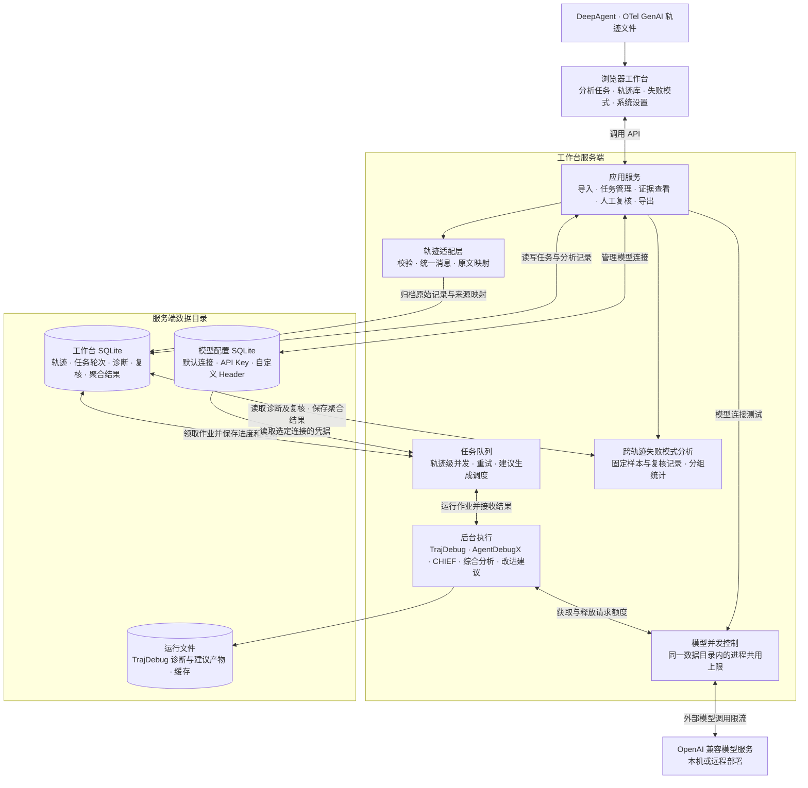
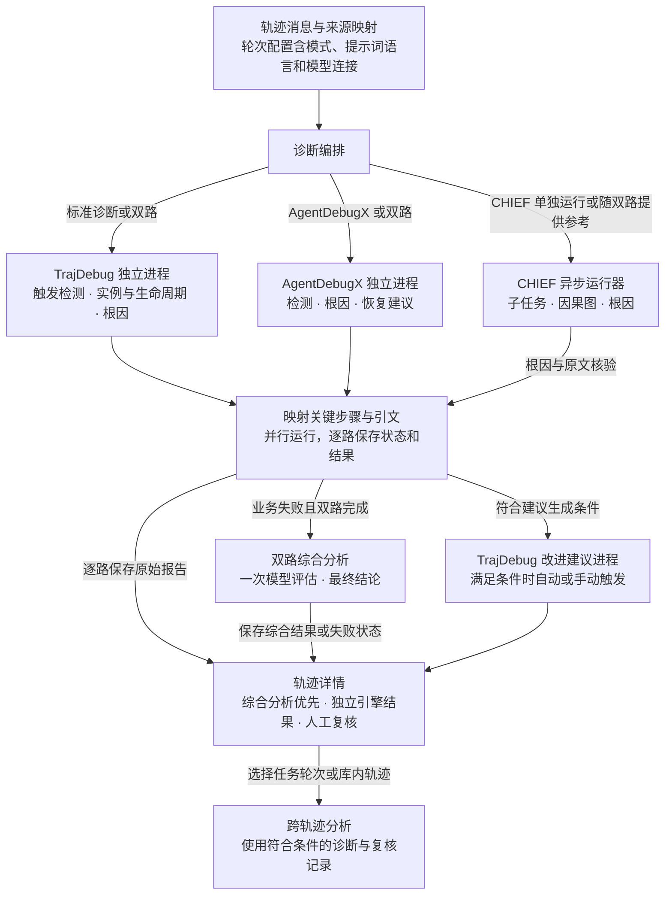

# 天罗智能轨迹诊断系统架构

天罗把已采集的 Agent 轨迹转成**可核验的单轨迹诊断**，再基于已保存的诊断分析跨轨迹的重复失败模式。工作台面向研发和评测人员，负责组织任务、查看证据、人工复核和导出。后台支持 TrajDebug、AgentDebugX、CHIEF，以及可附加 CHIEF 参考结果的双路对照。

## 系统全景

## 单轨迹诊断与综合分析

1. **导入与适配。** 用户在创建任务或轨迹库上传 DeepAgent、OTel GenAI 文件。适配层保留原始 span，生成调用视图所需的数据，同时还原可供诊断的线性消息序列及其来源映射。校验在本地完成。业务结果未知时需要在开始分析前补齐。只有耗时和 token，或模型并发分支无法还原为串行会话的 OTel 轨迹，会在导入时给出具体错误。
2. **任务与执行。** 相同轨迹在库中去重，可以被多个任务复用。分析任务定义排查目标和轨迹范围。每轮分析形成独立记录，保存诊断深度对应的引擎模式、模型连接、提示词语言和执行参数快照。后台按轨迹排队执行，失败重试与重新生成均保留请求历史。
3. **诊断与证据。** TrajDebug 接收统一消息，给出错误触发、实例与生命周期。AgentDebugX 将同一消息投影为带来源的事件，运行官方检测、深度归因和恢复建议。CHIEF 在同一消息序列上构建子任务、Agent 和步骤数据流，回溯关键失败步骤。三个引擎各自保存原始输出，核验后的引用都可跳回轨迹原文。CHIEF 因果图作为推断依据展示。
4. **双路综合分析与复核。** 双路任务并行运行两个引擎，对齐关键步骤与原文引文。两路完成且业务失败时，使用同一轮次模型独立评估。评估输入包含两路结论、诊断过程摘要与对应轨迹原文。模型给出最终结论。当两路关键步骤不同，模型分别评估两路候选的置信度。后端核验引用，暂定置信度更高的候选并要求人工复核。置信度并列或两路证据均不足时，关键步骤待定。详情优先展示综合分析，两路原报告各自可查；任一路或综合分析失败时保留可用的引擎报告。两路定位到同一有效关键步骤时，该步骤直接作为系统结果，并标记免复核。综合分析显示可跳转的一致步骤，同时提示各引擎的原文引用缺口。仍可主动复核，人工结论优先并单独保存。选择高档诊断深度时，CHIEF 独立产出参考结论、证据和用量，双路综合及免复核仍依据 TrajDebug 和 AgentDebugX 的证据。
5. **跨轨迹分析。** 失败模式分析固定选用的诊断和复核记录，在本地对具备可用归因的失败轨迹分组。双路报告免复核或经人工确认后可参与聚合，样本仍需满足既有归因和证据条件。

## 离线评估

RSI 脚本独立于工作台的在线任务队列运行，当前评估入口复用 TrajDebug 后台运行器，读取标准 JSON、JSONL 和固定的数据分区。评分阶段使用独立标注与落盘的诊断结果。 [RSI 离线评估](rsi-evaluation.md)

## 关键设计决策

| 决策 | 理由与约束 |
| --- | --- |
| 在适配层处理来源差异 | 新增轨迹来源时复用调用视图和诊断输入契约。适配至少要交代消息顺序、业务结果和证据如何回到原始记录。 |
| 分别保留调用时间和诊断顺序 | 调用区间回答什么时候发生、哪些调用重叠。诊断步骤回答算法按什么顺序看到消息。来源映射让两个视图可以互相核对。 |
| 轨迹归库，结果归分析轮次 | 共享原始轨迹，保留不同模型和配置的诊断结果。删除任务会保留库内轨迹。仍被引用的轨迹或来源诊断受引用保护。 |
| 固定上游源码，在运行边界适配 | 三个引擎从仓库内置源码加载并校验哈希，按任务配置选择提示词语言。AgentDebugX 与 CHIEF 的分阶段中文模板分别维护。CHIEF 使用无 RAG 和无任务标准答案的生产路径。 |

## 部署与数据边界

默认按单机工作台部署。应用服务提供浏览器页面和 API，队列从本地数据库领取作业，TrajDebug、AgentDebugX 和改进建议使用独立进程，CHIEF 通过异步模型客户端随队列运行。业务轨迹、分析记录和复核保存在本地，原始运行产物保存在数据目录中。

诊断引擎共用系统设置中的默认模型连接，同一轮次的各引擎使用同一份模型配置。分析记录保存接口地址、模型标识、运行参数和连接 ID。后端执行时从对应连接读取 API Key 与自定义 Header。使用远程模型时，推理所需的轨迹内容会发送到所选模型服务。文件校验、时序展示、人工复核和已有诊断的聚合均由本地工作台处理。

轨迹并发限制同时处理的作业数量，模型并发限制整个工作台同时调用模型的数量。TrajDebug、AgentDebugX、CHIEF、改进建议、综合分析和连接测试共用额度。模型并发上限在保存后生效，运行中的请求可以完成，等待中的请求按新上限取得额度。额度由共享数据目录的进程锁协调。

## 文档维护

当系统边界、组件职责、轨迹接入、诊断契约、数据引用关系或部署方式变化时，随代码更新对应段落或架构图。这里记录当前系统如何工作及关键决策的理由。接口字段、算法阶段、实验结果和部署命令各自维护在专项文档中。

- [用户旅程](user-journey.md)
- [TrajDebug 接入与运行参考](trajdebug-integration.md)
- [AgentDebugX 接入与运行参考](agentdebugx.md)
- [OTel GenAI 接入说明](otel-genai.md)
- [算法优化维护日志](algorithm-optimization-log.md)
