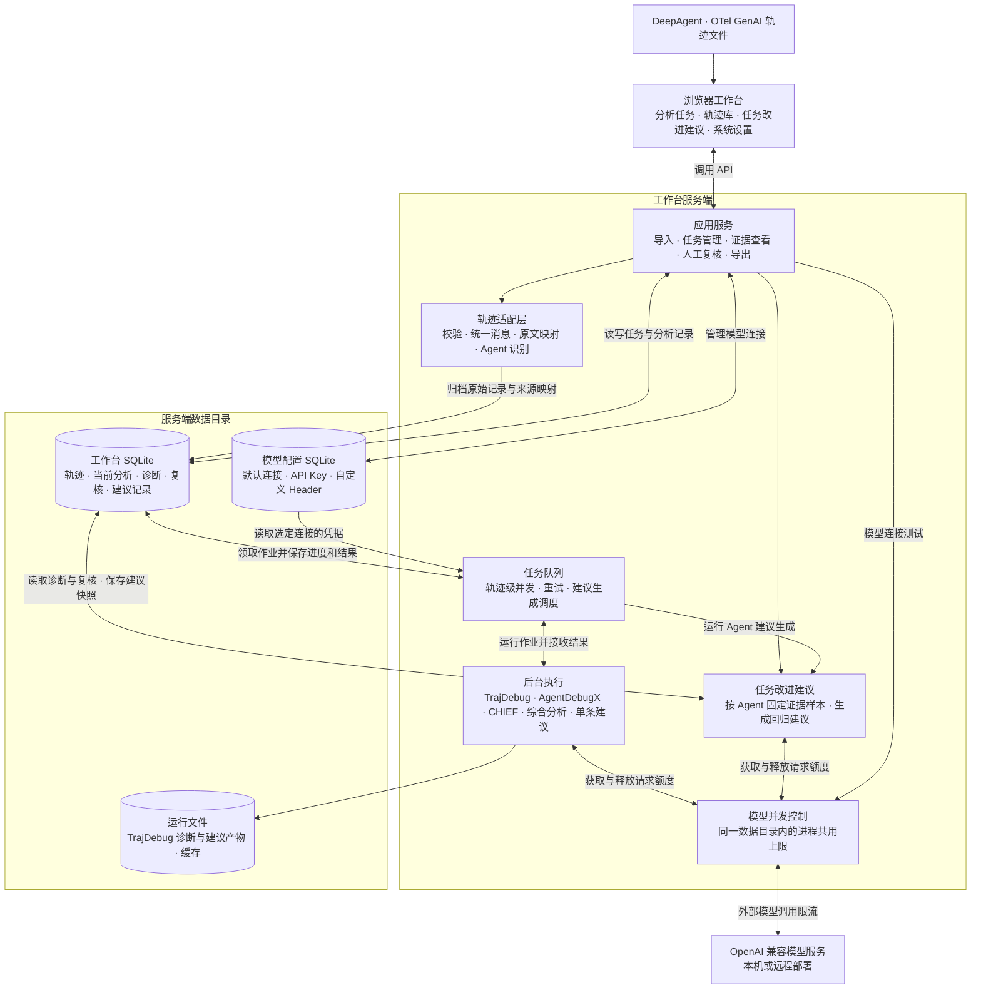
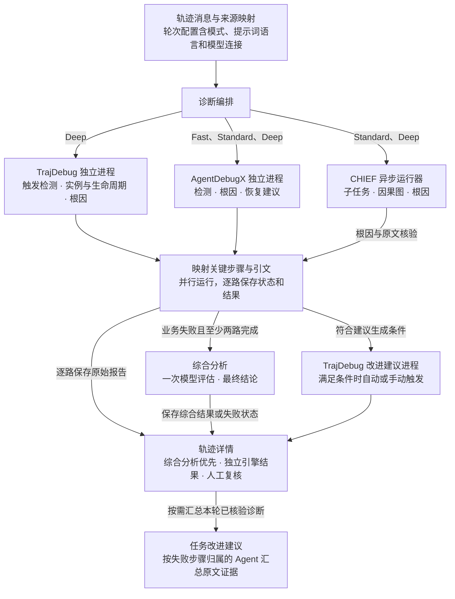

# 天罗智能轨迹诊断系统架构

天罗把已采集的 Agent 轨迹转成**可核验的单轨迹诊断**，再按 Agent 汇总一轮分析的失败证据，生成任务改进建议。工作台面向研发和评测人员，负责组织任务、查看证据、人工复核和导出。后台按 Fast、Standard、Deep 三个诊断等级运行 AgentDebugX、CHIEF 和 TrajDebug。

## 系统全景

## 单轨迹诊断与综合分析

1. **导入与适配。** 用户在创建任务或轨迹库上传 DeepAgent、OTel GenAI 文件。适配层保留原始 span，生成调用视图所需的数据，同时还原可供诊断的线性消息序列及其来源映射。入口 Agent 作为工作台元数据保存，用于列表展示和搜索。关键步骤的归属沿消息来源和 span 父子关系解析。校验在本地完成。业务结果未知时需要在开始分析前补齐。只有耗时和 token，或模型并发分支无法还原为串行会话的 OTel 轨迹，会在导入时给出具体错误。
2. **任务与执行。** 相同轨迹在库中去重，可以被多个任务复用。分析任务定义排查目标和轨迹范围，工作台展示当前分析及其配置。后台为每次执行保存诊断等级、模型连接、提示词语言和运行参数快照，当前任务内重试沿用该快照。替代分析全部完成后，后台清理启用此功能后产生的、已被替代且未被引用的结果。已有历史数据和仍被旧报告引用的结果保留用于核对。
3. **诊断与证据。** TrajDebug 接收统一消息，给出错误触发、实例与生命周期。AgentDebugX 将同一消息投影为带来源的事件，运行官方检测、深度归因和恢复建议。CHIEF 在同一消息序列上构建子任务、Agent 和步骤数据流，回溯关键失败步骤。子任务范围须连续覆盖轨迹才能构图，校验失败时仅重试任务分解阶段一次。三个引擎各自保存原始输出，核验后的引用都可跳回轨迹原文。CHIEF 因果图作为推断依据展示。
4. **综合分析与复核。** Fast 运行 AgentDebugX，Standard 默认并行运行 AgentDebugX 和 CHIEF，Deep 并行运行全部三个引擎。业务失败且至少两路完成时，同一轮次的模型评估所有已完成引擎的结论、诊断过程摘要及可核验的原文。全部引擎完成且定位到同一有效步骤时，采用一致步骤并标记免复核，引用缺口单独提示。存在分歧、未定位或引擎未完成时，综合分析分别给出参与引擎的候选置信度。证据支持最高且唯一的步骤作为暂定结果，需人工复核。不同步骤的最高置信度并列或证据均不足时，关键步骤待定。详情保留各引擎的原始报告，人工结论单独保存并优先。历史报告保留当时的综合范围。
5. **任务改进建议。** 用户按需为最新分析轮次生成建议。系统固定当时的诊断、复核和代表性原文证据，以关键失败步骤所属的 Agent 分组。多引擎有分歧的样本在人工确认后可参与；缺少原文或归属的样本汇总为未纳入原因。后台按 Agent 生成建议并校验引用。报告记录纳入数量、样本覆盖、建议改动和回归验证方式。历史失败模式任务可查看和导出已有记录。

## 离线评估

RSI 脚本独立于工作台的在线任务队列运行，当前评估入口复用 TrajDebug 后台运行器，读取标准 JSON、JSONL 和固定的数据分区。评分阶段使用独立标注与落盘的诊断结果。 [RSI 离线评估](rsi-evaluation.md)

## 关键设计决策

| 决策 | 理由与约束 |
| --- | --- |
| 在适配层处理来源差异 | 新增轨迹来源时复用调用视图和诊断输入契约。适配至少要交代消息顺序、业务结果和证据如何回到原始记录。 |
| 分别保留调用时间和诊断顺序 | 调用区间回答什么时候发生、哪些调用重叠。诊断步骤回答算法按什么顺序看到消息。来源映射让两个视图可以互相核对。 |
| 轨迹归库，任务展示当前结果 | 同一轨迹可供多个任务使用，执行配置与诊断结果对应。删除任务会保留库内轨迹。引用中的轨迹和来源诊断受保护。 |
| 固定上游源码，在运行边界适配 | 三个引擎从仓库内置源码加载并校验哈希，按任务配置选择提示词语言。AgentDebugX 与 CHIEF 的分阶段中文模板分别维护。CHIEF 使用无 RAG 和无任务标准答案的生产路径。 |

## 部署与数据边界

默认按单机工作台部署。应用服务提供浏览器页面和 API，队列从本地数据库领取作业。TrajDebug、AgentDebugX 和 TrajDebug 单条建议使用独立进程。CHIEF 和任务改进建议使用异步模型客户端。业务轨迹、分析记录、复核和任务改进建议保存在本地，原始运行产物保存在数据目录中。

诊断引擎共用系统设置中的默认模型连接，同一轮次的各引擎和任务改进建议使用已保存的模型配置。分析记录保存接口地址、模型标识、运行参数和连接 ID。后端执行时从对应连接读取 API Key 与自定义 Header。使用远程模型时，推理所需的轨迹内容会发送到所选模型服务。生成任务改进建议时，模型仅接收任务目标、Agent 名称、有限的诊断摘要和已核验的原文片段。文件校验、时序展示、人工复核和样本筛选均由本地工作台处理。

轨迹并发限制同时处理的作业数量，模型并发限制整个工作台同时调用模型的数量。TrajDebug、AgentDebugX、CHIEF、改进建议、综合分析和连接测试共用额度。模型并发上限在保存后生效，运行中的请求可以完成，等待中的请求按新上限取得额度。额度由共享数据目录的进程锁协调。

## 文档维护

当系统边界、组件职责、轨迹接入、诊断契约、数据引用关系或部署方式变化时，随代码更新对应段落或架构图。这里记录当前系统如何工作及关键决策的理由。接口字段、算法阶段、实验结果和部署命令各自维护在专项文档中。

- [用户旅程](user-journey.md)
- [TrajDebug 接入与运行参考](trajdebug-integration.md)
- [AgentDebugX 接入与运行参考](agentdebugx.md)
- [OTel GenAI 接入说明](otel-genai.md)
- [算法优化维护日志](algorithm-optimization-log.md)
